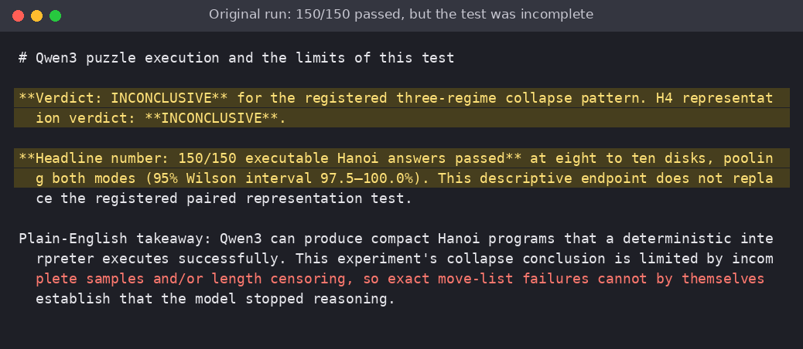
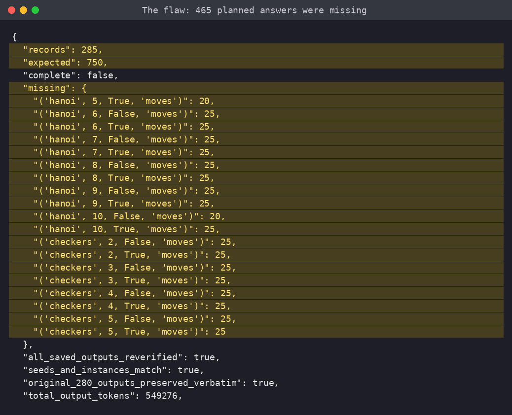
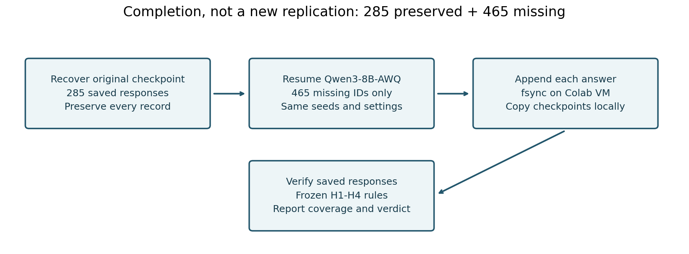
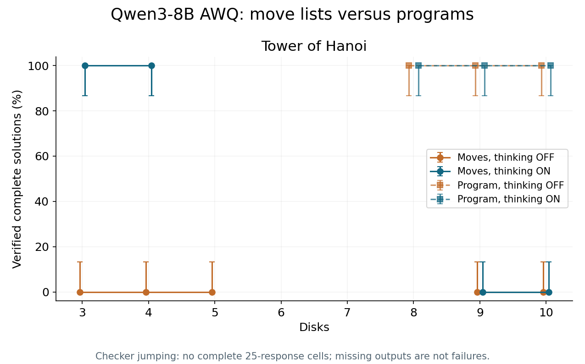
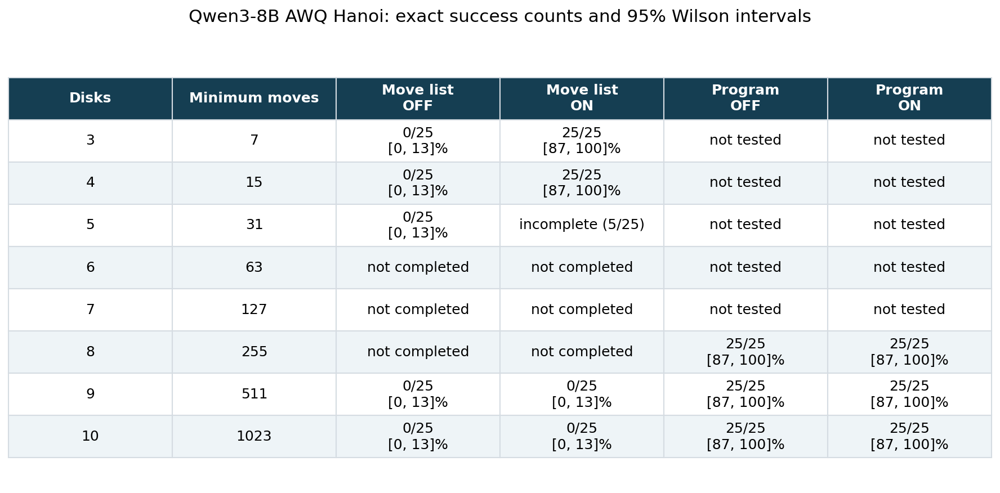
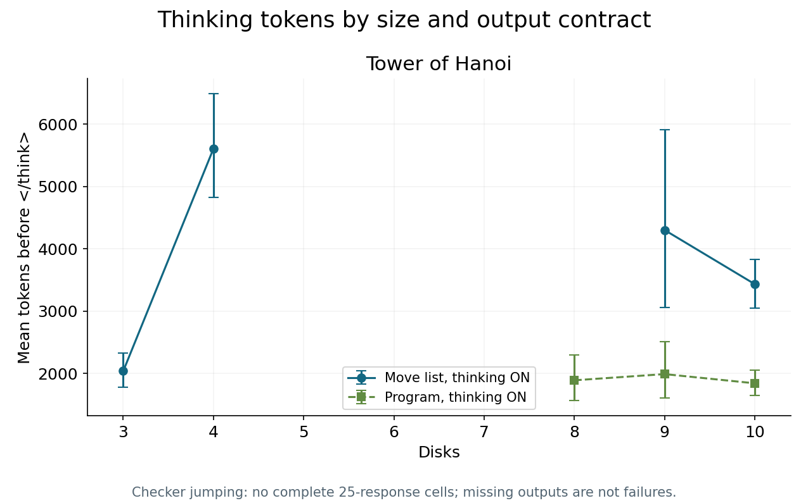
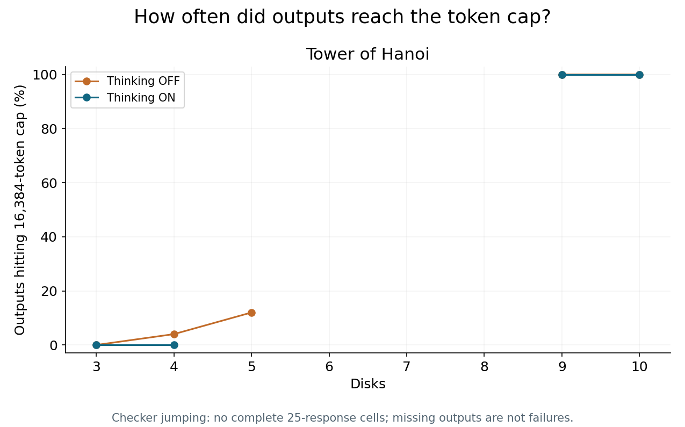
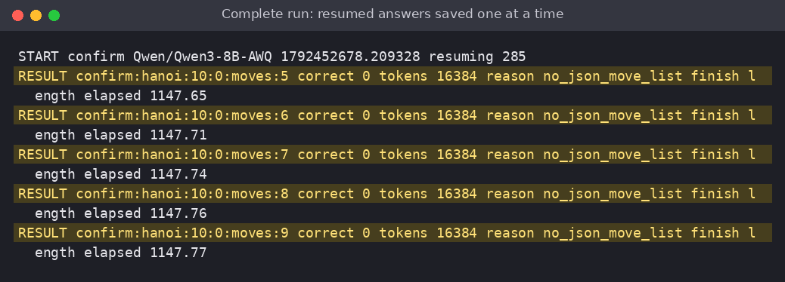

# 100/100 nine- and ten-disk move lists hit Qwen3's token cap

A continuation of one interrupted Qwen3 evaluation, with the original predictions left intact.

A model writes a recursive Hanoi solver, the interpreter runs it, and every disk reaches the right peg. Ask the same model to spell out every move, and the story can look very different. That difference matters whenever an engineer must choose between generating a long action sequence and generating a small program that produces it.

The popular claim behind this test comes from [The Illusion of Thinking](https://arxiv.org/abs/2506.06941v1): reasoning models face a “complete accuracy collapse beyond certain complexities.” That is a consequential claim about deploying models on long workflows. I wanted to know which part my own experiment could actually establish.

My expectation, registered before confirmation in the original run, was specific: thinking would help in the middle, both modes would fail at larger Hanoi puzzles, and measured thinking would first rise and then fall. A separate prediction said executable programs would recover more than 50 percentage points of accuracy on the largest puzzles. Those predictions survived into this follow-up unchanged.

## The first result looked cleaner than the experiment was

The earlier writeup's headline was **“150/150 executable Hanoi answers passed”**, with **“95% Wilson interval 97.5–100.0%.”** That is an excellent-looking endpoint. It is also only one side of a planned comparison.

The same writeup reported **“285/750”** saved confirmation responses and **“11/30”** complete cells. All four registered hypotheses were **INCONCLUSIVE**. Checker jumping had no saved confirmation responses. For ten-disk move lists, only five OFF answers had finished, and that partial cell was excluded from publication accuracy estimates.

*Screenshot 1: the original writeup reported 150/150 program successes while keeping the registered verdict INCONCLUSIVE.*

I got suspicious because the attractive program number was available while its paired move-list baseline was largely absent. Short programs finish quickly. Long enumerations can sit in flight when a runtime disappears. Looking only at finished answers can therefore select by response length before anyone calculates an accuracy rate.

The flaw was coverage. The earlier writeup correctly kept the verdict inconclusive. What would have been misleading was treating the successful program endpoint as a completed demonstration of the whole collapse story.

*Screenshot 2: the verifier audit lists the missing cells. There were 465 absent responses, rather than 465 observed failures.*

## What I tested

This is a continuation, not an independent replication. The raw checkpoint was missing from the old working tree, but Git still held its committed copy. I recovered that exact 285-response checkpoint into a new experiment folder, checked that every recovered answer retained its original record, and committed the protocol before new inference. The follow-up saved 95 additional responses, reaching 380/750; the registered sample remains incomplete. The newly requested items were previously unobserved planned items, separate from the old pilot; the final analysis deliberately retains the old responses.

The confirmation model was **Qwen/Qwen3-8B-AWQ**, with four-bit AWQ weights and BF16 activations and cache. It ran on an **NVIDIA L4** through vLLM 0.32.0. The original pilot used Qwen/Qwen3-4B; I did not rerun or expand that pilot to improve the predictions.

The public synthetic tasks were Tower of Hanoi at three through ten disks and checker jumping at two through five checkers per color. Every cell planned 25 responses. Thinking ON and OFF shared temperature 0.6, top-p 0.95, top-k 20, a 20,480-token context, and a 16,384-token output ceiling. Programs were requested only for Hanoi at eight through ten disks, in both modes.

*The pipeline preserves old answers, requests missing IDs, and applies the same deterministic checks and registered tests to saved responses.*

A state simulator replayed moves and checked the final board. Generated programs ran in a restricted, resource-limited subprocess, then went through that same simulator. This measures a model-plus-interpreter system in the program arm. It does not give the model credit for mentally executing its own recursion.

The runner saved each finished response immediately, including the rendered prompt, generation seed, actual token counts, finish reason, and verifier result. It ran detached on the GPU VM, while local polling copied checkpoints. That protects against losing a terminal connection, although it cannot guarantee survival if the GPU VM itself is pruned.

## The result, and the remaining missing answers

**The headline is 100/100 hit the token cap: nine- and ten-disk move-list responses; descriptive 95% Wilson 96.3 to 100.0%, with 380/750 responses retained overall.** The registered three-regime verdict is **INCONCLUSIVE**, and the separate representation verdict is **INCONCLUSIVE**.

At ten disks, the completed move-list cells scored OFF 0/25 (95% Wilson 0.0–13.3%), ON 0/25 (95% Wilson 0.0–13.3%). 50/50 move-list responses hit the output ceiling. The retained ten-disk programs passed 50/50. This level-specific description does not replace H4’s registered eight-to-ten-disk comparison.

*Exact success rates by puzzle size and output contract. Error bars are 95% Wilson intervals; incomplete cells are excluded.*

*Exact counts and Wilson intervals for Hanoi; incomplete cells are labelled explicitly.*

The medium-complexity thinking advantage was not estimable under the full-sample rule. Its frozen target was more than ten percentage points. The high-complexity program comparison was not estimable under the full-sample rule, against a target above fifty points. The planned 150-pair program-versus-moves comparison remains incomplete. Checker jumping has 0/200 saved responses; incomplete cells do not supply accuracy estimates.

The analysis resampled paired items within fixed strata 10,000 times, rather than treating the two output contracts as unrelated samples.

*Measured tokens before the thinking delimiter, with bootstrap uncertainty. These are observed lengths, not a direct measurement of reasoning quality.*

The full-sample token-ratio test could not be estimated from the saved coverage. The original rule required at least a 20% early rise and at least a 20% late fall. Moving the peak after seeing the graph would answer a different, easier question.

*The cap-hit chart identifies cells whose apparent failures or token lengths cannot support an uncensored collapse claim.*

That gate matters. The compact canonical ten-disk answer was measured at 4,094 tokens in the original setup, but fitting the answer does not guarantee that thinking plus the answer fits. A response stopped by the ceiling is a task failure under this output contract. It does not establish that the model freely chose to stop thinking. A separate higher-budget test would be needed to learn whether additional tokens improve the answer.

*Screenshot 3: real RESULT lines from the resumed runner, with token counts and termination reasons.*

*Screenshot 4: the frozen hypothesis program's final output. The raw JSON is in the results folder.*

## What surprised me, and what I got wrong

The original expectation tried to connect several different measurements into one story. Completing coverage tests that story; it does not entitle me to simplify it. The individual verdicts are H1 **INCONCLUSIVE**, H2 **INCONCLUSIVE**, H3 **INCONCLUSIVE**, and H4 **INCONCLUSIVE**. A missed threshold stays missed, and a censoring gate stays binding.

I also underestimated the runtime. My plan was 230 minutes. The run is still in progress; its final duration is pending. Coverage reached 380/750 under the eight-CU ceiling. The original sample sizes and decoding settings stayed fixed. Long responses and runtime recovery consumed the available compute, and the remaining missing answers remain missing.

The other warning was already present at three disks: OFF failed all 25 answers while ON passed all 25. That weak OFF baseline limits any narrative about falling from competence. It also cautions against treating this exact prompt and shared sampling recipe as the best possible non-thinking configuration.

## What I would do in production

1. Use a tested deterministic solver when one already exists. For model-generated plans, prefer a small executable program when the task is naturally algorithmic. Validate its output against domain rules before applying actions.
2. Save each request independently, including failures, finish reasons, and tokenizer counts. Build the denominator from planned IDs, not whatever files happen to arrive first.
3. Separate invalid actions, unfinished goals, and token-cap failures in dashboards. They suggest different interventions.
4. Freeze the comparison and its stopping rules before paying for the full evaluation. Replotting a more convenient peak is exploration and deserves a new test.

5. Measure long-response throughput and check easy baselines before funding a full evaluation. Include recovery time in the budget.

## Limits worth keeping

This is one quantized model on renamed, nonce-varied versions of the same mathematical structures. Those are repeated sampling trials, not hundreds of unrelated reasoning problems. Restarted batching can change floating-point samples even with unchanged seeds. The intervals are nominal per hypothesis, without a familywise correction. Percentile bootstrap intervals can have zero width at all-success or all-failure endpoints. I retained the registered calculation and show Wilson accuracy intervals in the table.

Our 16,384-token ceiling is also smaller than the [original paper’s 64,000-token setup](https://arxiv.org/html/2506.06941v1). The censoring gate applies to the whole response, including the final answer, even if its thinking delimiter appeared earlier.

The [corrected rebuttal](https://arxiv.org/abs/2506.09250v2) motivates checking output contracts and token limits, but this experiment does not adjudicate all models or puzzles in either paper. It also does not convert a model-plus-interpreter result into proof of unaided reasoning ability.

Timing: estimated 230 minutes; actual duration and final CU pending; NVIDIA L4; inference is still running. The earlier run's cost is historical and excluded from this follow-up's cap. Full measurements, the original protocol, preserved answers, logs, and the table image are in this folder.

Before trusting a collapse chart, check what finished, what was missing, and what the runtime stopped. Those distinctions can change what the same failure rate means.

Code: <repo link placeholder>
