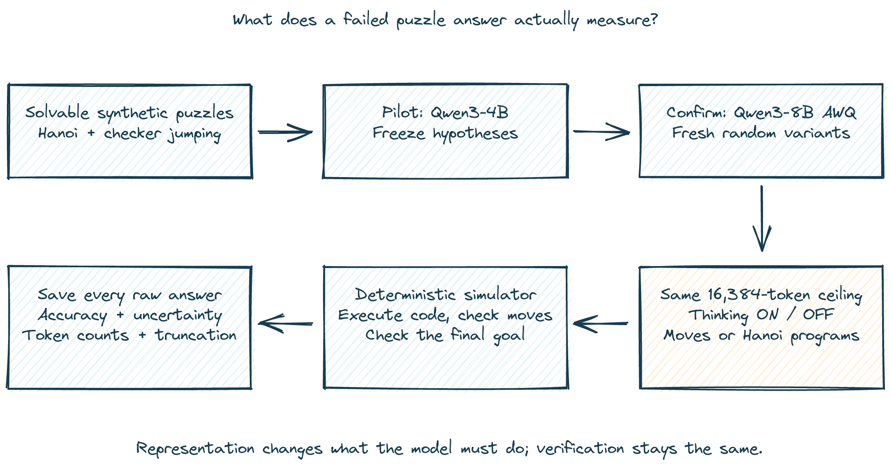
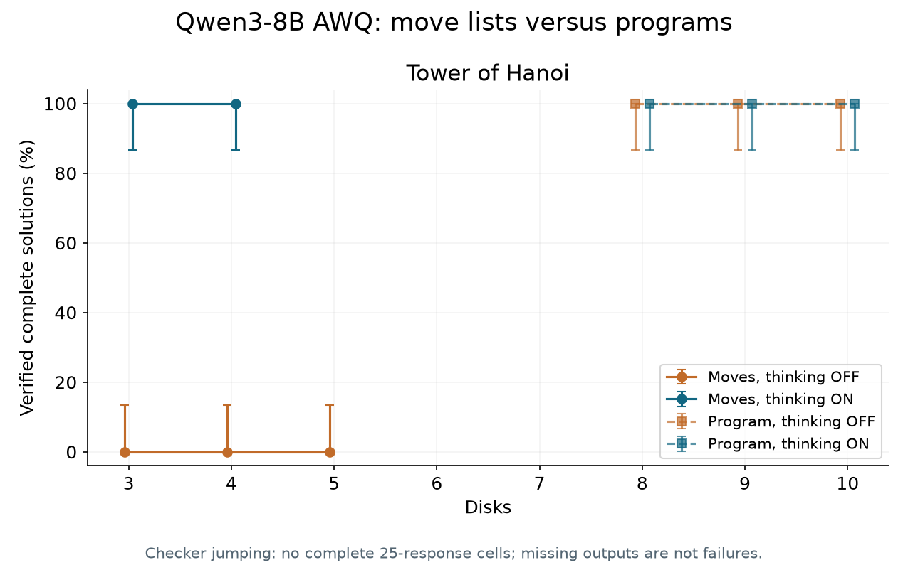
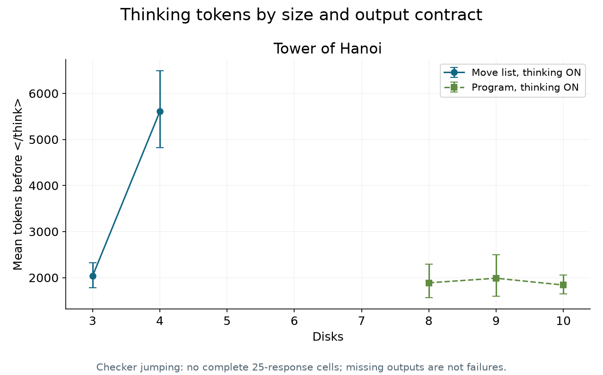
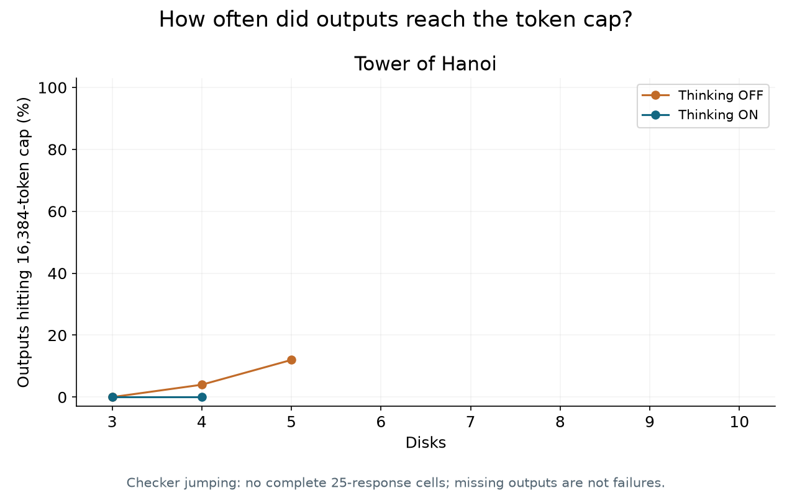

# Qwen3 solved all 150 Hanoi program tasks, but that doesn't settle reasoning collapse

One open model, a strict move verifier, and the gap between writing a procedure and executing it.

Apple's *The Illusion of Thinking* says reasoning models face a “complete accuracy collapse beyond certain complexities.” [The paper](https://arxiv.org/abs/2506.06941) makes that claim using puzzles whose difficulty can be increased while keeping the rules fixed.

Imagine using a model to produce a migration plan with hundreds of dependent steps. If extra thinking stops helping once the plan gets long enough, you need to know before building a workflow around it.

But a puzzle score leaves an engineering question open. Did the model fail to find a method, fail to execute that method, or run out of room while writing the answer?

**150 out of 150 executable Hanoi answers passed the verifier**, across eight, nine and ten disks and both thinking modes. The pooled 95% Wilson interval is 97.5% to 100%, though these are randomized versions of the same familiar puzzle, not 150 unrelated algorithms. This completed program result is useful; the claim that programs outperform move lists still needs its paired comparison.

## What I tested

I compared thinking ON and OFF using the official **Qwen/Qwen3-8B-AWQ** release. This is an eight-billion-parameter model with four-bit AWQ weights, served by vLLM on one NVIDIA L4. The activations and key-value cache used BF16. These results apply to that quantized release.

There were two puzzle families. Tower of Hanoi ranged from three to ten disks. Checker jumping ranged from two to five checkers of each color. In the checker puzzle, the two groups must exchange sides using forward slides and jumps over the opposite color.

Every configuration was solvable. A recursive Hanoi solver and an exhaustive checker search checked that before scoring model answers. The verifier then simulated each proposed move and checked the final state. A convincing explanation earned nothing if a move was illegal or the goal was unfinished.

For Hanoi at eight, nine and ten disks, I added a second output contract: write a Python function that returns the moves. The evaluator executed it and sent the resulting list through the same verifier. 

That arm builds on [Alex Lawsen's rebuttal](https://arxiv.org/abs/2506.09250): distinguish exhaustive enumeration from a program that generates the answer. I used its corrected second version, which revises an earlier output-length calculation. Its program test was preliminary, so the proposal needs a measured comparison.

The plan was 750 responses, with 25 per level, mode and output contract. Hanoi peg names and generation seeds varied. Checker boards stayed structurally identical, with fresh irrelevant identifiers. These are repeated trials on familiar structures, not hundreds of unrelated reasoning problems.

Both modes received the same 16,384-token output ceiling. Temperature was 0.6, top-p 0.95 and top-k 20. I held sampling constant to compare the thinking switch; I didn't optimize OFF separately. The ceiling covers both reasoning and the final answer, so equal limits don't imply equal actual compute.

A compact ten-disk Hanoi solution measured 4,094 tokens with the model's tokenizer. The literal answer fits, but a long reasoning trace can still exhaust the allowance. I saved generated-token counts and termination reasons for exactly that reason.

The setup changes the requested representation while keeping the final state verifier fixed. The program arm adds a deterministic interpreter, which is a meaningful change to the system being evaluated.

## The predictions were frozen first

I ran a small Qwen3-4B pilot before the eight-billion-parameter confirmation. It stopped after 18 of 36 planned responses to reserve the compute budget. Unfinished pilot requests were left unscored. That incomplete pilot is a weakness of the forecast, not additional evidence for failure.

The preregistration was committed before any confirmation inference. I predicted four things.

I predicted a thinking advantage above ten percentage points at four through six disks; below-ten-percent accuracy for both move-list modes at seven through ten; a twenty-percent thinking-token rise from three to five, then a twenty-percent fall from five to ten; and a program advantage above fifty percentage points at eight through ten. The levels and margins stayed fixed. I couldn't move the peak after seeing a nicer curve.

I also registered a censoring rule. A claim about uncensored collapse or shrinking reasoning would need no more than five percent cap hits in each relevant cell. If the model kept talking until the ceiling, I couldn't call that evidence it voluntarily thought less.

## What happened

The collapse experiment is **INCONCLUSIVE**. Only 285 of the planned 750 confirmation responses survived locally. Both Colab allocations were pruned, and the second interruption left too little of the six-CU allowance to finish the remaining sample after another setup. All four registered hypotheses remain inconclusive, including the claim that programs beat move lists. A completed program arm cannot supply the missing paired baseline.

Thinking ON solved 25/25 instances at both three and four disks; OFF solved 0/25 at three, four and five. At each individual level, the 95% Wilson interval is 86.7–100% for 25/25 and 0–13.3% for 0/25. Blank regions are missing measurements, not zero accuracy. The high-complexity move-list comparison is unavailable.

For complete move-list cells, mean thinking tokens rose from 2,036 at three disks to 5,606 at four. That does not test the registered five-disk peak or ten-disk decline: both needed complete cells that I don't have. Program answers used about 1,839–1,987 thinking tokens across eight to ten disks.

OFF move lists hit the ceiling in 0/25, 1/25 and 3/25 responses at three, four and five disks. Every saved program answer finished below the ceiling. The five-disk OFF rate already exceeds the registered five-percent gate, although that level is outside H2's high-complexity range. Neither the plot nor the ten cap hits across all 285 saved outputs estimates truncation among missing requests.

The run saved 549,276 generated tokens and 48,566 prompt tokens, excluding the pilot and any lost in-flight work. Eleven of thirty cells are complete. Checker jumping has no saved confirmation outputs, so its generator validation is not a model result. The full count-and-interval table is supplied separately as `figures/table.png`.

## What surprised me / what I got wrong

I got the execution budget wrong. Long generations and cache pressure made the planned 750-response matrix much more expensive than the short program answers suggested. The pilot itself stopped early. Losing two VMs then exposed a gap in recovery: detached GPU work survived a local interruption only until the remote allocation disappeared, and answers after the last local copy could not be recovered.

I also assumed that making the literal ten-disk answer fit would keep truncation a minor issue. Five saved ten-disk OFF answers all hit the ceiling. They are an incomplete, scheduling-selected slice, so I won't report their accuracy as a level estimate. They do show that a token-fit calculation alone cannot guarantee an uncensored experiment.

The predicted peak-and-fall pattern was not established. There is no license to rename four disks the peak or treat missing high levels as evidence of decline. The clean result is narrower: all six planned program cells completed successfully.

There is also a baseline problem worth making explicit. Thinking OFF solved zero of 25 three-disk Hanoi instances, while ON solved all 25. A mode that starts at zero doesn't demonstrate a later fall from competence. Its poor performance on larger puzzles can meet a near-zero endpoint test without reproducing the original paper's trajectory.

One OFF answer illustrates how specific these failures can be. With source D, target F and auxiliary K, it produced four legal moves and then attempted F to F. This is an invalid move, not a token-budget failure. The full response and instance are saved, so the diagnosis doesn't depend on an impression of its prose.

## What I would do in production

**Ask for an executable artifact when the task permits it.** For a repetitive transformation, a short function can express the rule more reliably than a long list of expanded steps. Test it on the actual inputs before treating it as a solution.

**Give the verifier a separate job.** The model proposes a procedure. A deterministic executor checks state transitions and the final goal. For a migration, that could mean dry runs, invariants and explicit postconditions rather than asking the model whether its plan looks right.

**Measure different failure types separately.** A length-limited response, an illegal state transition and an unfinished but well-formed list lead to different interventions. Retrying all three with a larger thinking budget would hide that distinction.

**Budget the whole completion.** A final answer that fits in isolation doesn't guarantee the reasoning-plus-answer fits. Log the actual thinking and output tokens, and keep the termination reason alongside the task score.

## What this does and doesn't establish

This is one small, quantized open model on two toy puzzle families. It isn't a replication of every frontier model in Apple's paper. The randomized labels and identifiers don't remove possible familiarity with these classic puzzles, and they don't create fresh algorithmic structures.

Twenty-five responses per cell gives coarse estimates. I saved bootstrap intervals as requested and displayed Wilson intervals for accuracy, since an ordinary bootstrap gives a misleadingly zero-width interval at zero or perfect observed success. The hypothesis comparisons use the registered resampling rules and nominal 95% intervals, without a familywise significance claim.

The program arm measures a model plus an interpreter. Success there demonstrates the ability to produce an executable procedure for these instances. It doesn't establish that the model could mentally execute every move, solve unfamiliar planning tasks, or reliably generate arbitrary production code.

Timing: estimated 115 minutes; actual 303.6 minutes including recovery gaps, on NVIDIA L4, at an estimated 4.484 CU (conservative bookkeeping upper estimate 4.665 CU).

The next test needs fewer cells or a better throughput pilot, durable remote checkpoints, and a budget validated against the longest responses. This run leaves the collapse debate open while documenting a useful capability: this model consistently wrote executable Hanoi procedures under the tested conditions.

Code and saved results: this repository.
